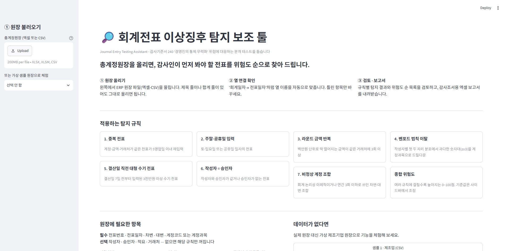
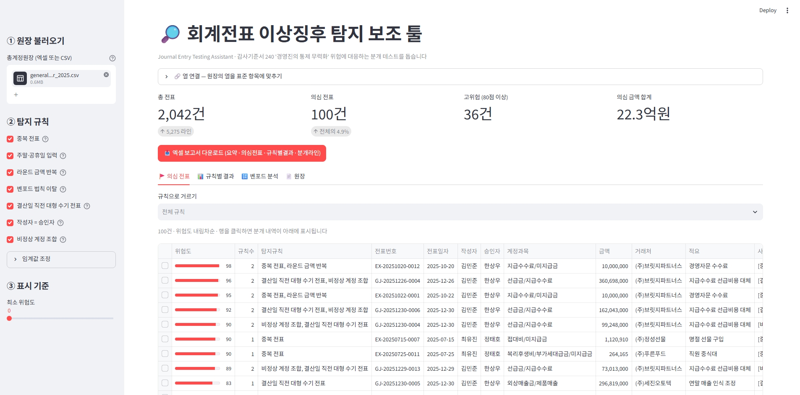
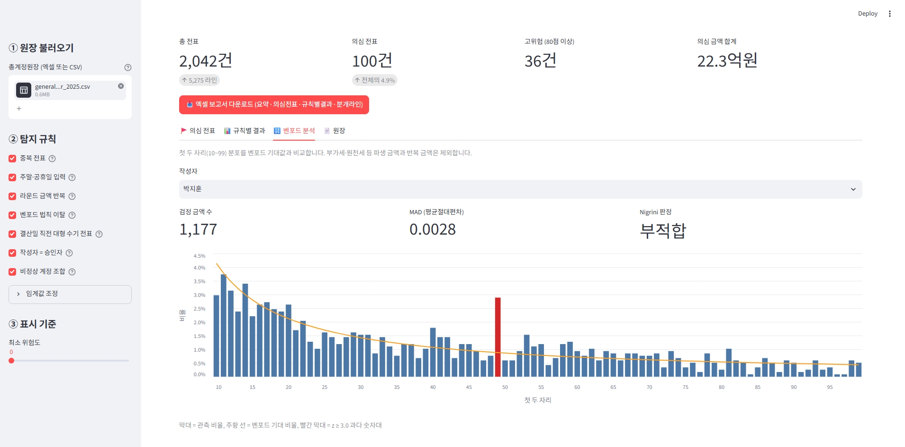

# 회계전표 이상징후 탐지 보조 툴 (Journal Entry Testing Assistant)

회계감사 기준서(ISA 240 / 감사기준서 240)의 **경영진의 통제 무력화 위험 대응 절차 — 분개 테스트**에서
감사인이 먼저 검토할 전표를 골라 주는 파이썬 보조 툴입니다. 최종 판단은 감사인이 합니다.
이 프로젝트는 Claude Code 도구의 도움을 받아 만들었습니다. 저는 아이디어와 요구사항을 정하고, 결과를 검토·수정했습니다.

## 화면







**결과 요약** (가상 원장 20종 반복 평가): 탐지율 **100%** · 오탐률 평균 **0.3%** · 위험도 상위 50건 적중률 **100%**

| 단계 | 내용 |
|---|---|
| 1 | 중소 제조기업 1년치 가상 총계정원장(약 5,000행) + 이상 전표 99건 + 정답 라벨 |
| 2 | 탐지 규칙 7개(독립 함수, 점수·사유 반환)와 종합 위험도 |
| 3 | Streamlit 대시보드 — CSV 업로드, 규칙별 결과, 위험도순 목록, 벤포드 차트, 엑셀 보고서 |
| 4 | 정답 라벨 대비 탐지율·오탐률 평가, 결과 해석과 한계 |

## 빠른 시작

```bash
python -m venv .venv
.venv\Scripts\activate
pip install -r requirements.txt

python scripts/generate_data.py --seed 42 --out-dir data   # 가상 GL + 정답 라벨 생성
streamlit run app/streamlit_app.py                        # 대시보드 (http://localhost:8501)
python scripts/evaluate.py                                # 탐지 성능 평가 (README 결과표 갱신)
pytest                                                    # 테스트
```

## 폴더 구조

```
je-anomaly-detector/
├── src/je_anomaly/
│   ├── calendar_kr.py      # 2025 공휴일·영업일
│   ├── generator.py        # 가상 원장 + 정답 라벨 생성
│   ├── ledger.py           # 원장 검증·형 변환·전표 요약
│   ├── mapping.py          # 엑셀/CSV 읽기, 머리글 감지, ERP 열 이름 자동 연결
│   ├── rules/              # 탐지 규칙 7개 (규칙당 1파일)
│   ├── scoring.py          # 종합 위험도
│   ├── report.py           # 엑셀 보고서
│   └── evaluation.py       # 탐지율·오탐률 평가
├── app/streamlit_app.py    # 대시보드
├── scripts/                # generate_data.py, evaluate.py, make_erp_sample.py
├── data/                   # 가상 원장, 정답 라벨, ERP 형식 연습용 엑셀
├── evaluation/             # report.md, multi_seed.csv (평가 결과)
└── tests/                  # pytest 75개
```

## 1단계: 가상 데이터

중소 제조기업(자동차 부품)의 2025 회계연도 총계정원장 약 5,000행.

| 파일 | 내용 |
|---|---|
| `data/general_ledger_2025.csv` | 전표번호, 전표일자, 작성자, 승인자, 계정코드, 계정과목, 차변, 대변, 적요, 거래처 |
| `data/labels_2025.csv` | 전표번호, is_anomaly, anomaly_type (툴은 이 파일을 보지 않음) |

**전표번호 규칙** `GJ-20251231-0007` = {입력원천}-{일자}-{일련번호}.
`GJ`는 수기 전표, `SA`(매출)·`RC`(수금)·`PU`(매입)·`PM`(지급)·`EX`(경비)·`PY`(급여)는 모듈 자동연계 전표.

**내부통제 설정** 500만원 미만은 회계팀장(정태호), 500만원 이상은 재무부장(한상우) 승인.

### 심어 둔 이상 전표

| 유형 | 건수 | 시나리오 |
|---|---:|---|
| DUPLICATE | 15 | 동일 송장을 0~3 영업일 뒤 재입력 (이중 지급) |
| WEEKEND_HOLIDAY | 15 | 주말·공휴일에 입력된 수기 경비 전표 |
| ROUND_AMOUNT | 15 | 실체 불분명한 자문사에 300만/500만/1,000만원 반복 지급 |
| BENFORD | 20 | 부장 승인(500만원) 회피용 490~499만원 분할 지급 → 첫 두 자리 49 과다 |
| PERIOD_END_MANUAL | 10 | 12/24 이후 5천만~4억원 수기 전표 (매출 선인식, 비용 이연) |
| SELF_APPROVAL | 12 | 작성자 = 승인자 |
| UNUSUAL_PAIR | 12 | 가지급금/매출, 외상매입금/매출, 개발비/급여 등 비정상 계정 조합 |

### 의도적으로 넣은 "정상인데 의심스러운" 거래 (오탐 후보)

실무 데이터처럼 탐지 규칙이 헷갈릴 만한 정상 거래를 섞어 두었습니다.

- 매월 공장 임차료 **3,000,000원 고정** → 라운드 금액 반복이지만 정상
- 매월 말 감가상각 **수기 전표 12,450,000원** → 12월 말 결산 수기 전표이지만 정상

## 2단계: 탐지 규칙

```python
from je_anomaly.ledger import prepare
from je_anomaly.scoring import detect

gl = prepare(pd.read_csv("data/general_ledger_2025.csv", dtype={"계정코드": str}))
results, scored = detect(gl)   # 규칙별 결과, 전표별 종합 위험도(내림차순)
```

모든 규칙은 `src/je_anomaly/rules/`에 **독립 함수**로 있고, 같은 형식(`전표번호 | rule_id | score | reason`)을 반환합니다.
임계값은 모두 함수 인자라서 감사인이 수행중요성 등에 맞춰 조정할 수 있습니다.

| # | 규칙 | 판단 기준 (기본값) | 점수 |
|---|---|---|---:|
| 1 | 중복 전표 | 계정·금액·거래처 구성이 같은 전표가 5영업일 이내 재입력 | 80 (같은 날 90) |
| 2 | 주말·공휴일 | 토·일요일, 2025 공휴일(대체·임시공휴일 포함) | 60 |
| 3 | 라운드 금액 반복 | 전표 금액이 100만원 배수 & 같은 거래처 3회 이상 | 40 + 5×(초과 횟수), 최대 75 |
| 4 | 벤포드 이탈 | 작성자별 첫 두 자리 검정(z≥3) → 계정과목 드릴다운(z≥3) | 40 + 4z, 최대 80 |
| 5 | 결산 직전 대형 수기 | 결산일 7일 전부터, `GJ` 전표, 3천만원 이상 | 50 + 10·log₂(금액/기준), 최대 90 |
| 6 | 작성자 = 승인자 | 작성자와 승인자 동일 / 승인자 누락 | 70 / 60 |
| 7 | 비정상 계정 조합 | 회계 논리 패턴 위반 또는 연간 3회 이하 조합 | 70 / 40 / 둘 다 80 |

**종합 위험도** = 100 × (1 − Π(1 − 규칙점수/100)). 단순 합계와 달리 100을 넘지 않고, 걸린 규칙이 많을수록 100에 가까워집니다. (예: 60점 + 70점 → 88점)

### 설계 판단

- **벤포드는 작성자 단위로 검정합니다.** 전체 모집단(약 2,000건)에서는 한 사람의 쪼개기 20건이 희석되어 유의하지 않았습니다. 계정과목 단위로 검정하면 통신비·복리후생비처럼 금액대가 좁은 계정이 원래 벤포드를 따르지 않아 오탐이 100건 넘게 나왔습니다. 작성자는 여러 계정을 다루므로 금액이 여러 자릿수에 걸쳐 분포하고, 과다 숫자대를 계정과목으로 드릴다운하면 원인 전표만 남습니다.
- **벤포드 검정 전에 반복 금액을 제거합니다.** 매월 같은 임차료(3,300,000원)는 벤포드가 아니라 중복·라운드 검사의 대상입니다 (Nigrini의 number duplication 선제거).
- **비정상 계정 조합은 규칙 + 희소성을 함께 씁니다.** "수익의 상대계정이 현금·채권이 아님", "비용을 자산으로 대체", "재고를 판관비로 직접 대체" 같은 회계 논리 패턴(더존 계정코드 범위 기준)과, 회사 안에서 연간 3회 이하로만 쓰인 조합을 함께 봅니다.
- **수기 전표 여부는 전표번호 접두어(`GJ`)로 판단합니다.** 실제 ERP에서는 전표유형·입력원천 필드로 바꾸면 됩니다 (`manual_pattern` 인자).

## 3단계: Streamlit 대시보드

`streamlit run app/streamlit_app.py`

| 영역 | 기능 |
|---|---|
| 사이드바 | 엑셀(.xlsx)·CSV 업로드(UTF-8·CP949 자동 인식, 시트 선택) 또는 샘플 데이터, 규칙 선택, 임계값·결산일 조정, 최소 위험도 필터 |
| 🔗 열 연결 | ERP마다 다른 열 이름을 표준 10개 항목에 연결 (아래 참고) |
| 상단 지표 | 총 전표 · 의심 전표(비율) · 고위험(80점 이상) · 의심 금액 합계, 대차 불일치 전표 경고 |
| 🚩 의심 전표 | 위험도 내림차순 목록, 규칙별 필터, 행 클릭 시 탐지 사유와 분개 라인 표시 |
| 📊 규칙별 결과 | 규칙별 건수·금액, 위험도 분포, 규칙별 상세 목록 |
| 🔢 벤포드 분석 | 작성자별 첫 두 자리 분포 vs 기대값 차트, MAD와 Nigrini 판정, 과다 숫자대 강조 |
| 📄 원장 | 전표번호·적요·거래처 검색 |

**엑셀 보고서** (`src/je_anomaly/report.py`): 현재 필터가 적용된 결과를 감사 조서에 바로 붙일 수 있게 4개 시트로 내보냅니다.
`요약`(작성 시각·규칙별 건수/금액) · `의심전표`(위험도순) · `규칙별결과`(전표 × 규칙별 사유) · `분개라인`(의심 전표의 원장 라인, 위험순위순)

### 어느 ERP 원장이든 올리기 (`src/je_anomaly/mapping.py`)

ERP에서 내려받은 원장은 회사마다 모양이 다릅니다. 엑셀을 손으로 고치지 않고 그대로 올릴 수 있게 했습니다.

| ERP 원장의 흔한 모양 | 처리 방법 |
|---|---|
| 위쪽에 제목·회사명·조회기간 줄 | 알려진 열 이름이 가장 많은 줄을 머리글로 자동 감지 (직접 지정도 가능) |
| 열 이름이 다름 (회계일자, 입력자, 결재자, 계정명, 차변금액 …) | 별칭 사전으로 자동 연결 → 화면에서 확인·수정 |
| 쓰지 않는 열(부서, 증빙구분)과 다른 열 순서 | 무시 |
| 맨 아래 합계·소계 줄 | 전표번호가 없는 줄은 제외하고 몇 줄 뺐는지 표시 |
| 날짜 형식 (`2025-01-02`, `2025.01.02`, `20250102`, 엑셀 날짜 셀) | 모두 인식, 못 읽는 날짜는 예시와 함께 오류 표시 |
| 승인자 열이 없는 원장 | 그 열이 필요한 '작성자 = 승인자' 규칙만 자동으로 끔 |
| 3월·6월 결산법인 | 사이드바에서 결산일 지정 |

연습용으로 일부러 ERP 추출본처럼 만든 엑셀(`data/sample_erp_export_2025.xlsx`)이 있습니다. 올려 보면 자동 연결 결과를 볼 수 있습니다 (`python scripts/make_erp_sample.py`로 다시 생성).

**아직 지원하지 않는 형식:** 금액 한 열 + 차대구분 열(예: `구분=1 차변 / 2 대변`) 원장, 2025년 외 연도의 공휴일(주말만 탐지).

## 4단계: 검증

```bash
python scripts/evaluate.py          # 평가 실행 → evaluation/report.md 저장 + 아래 표 자동 갱신
```

**평가 단위는 전표**이고, 정답은 `labels_2025.csv`입니다. 툴은 정답 라벨을 전혀 보지 않습니다.

- **탐지율(Recall)** = 잡아낸 이상 전표 ÷ 심어 둔 이상 전표 — 감사에서 더 치명적인 '놓침'의 반대
- **오탐률(FPR)** = 잘못 걸린 정상 전표 ÷ 전체 정상 전표
- **정밀도(Precision)** = 걸린 전표 중 실제 이상 비율 — 감사인이 검토할 목록의 '헛수고' 정도

### 결과

<!-- EVAL:START -->
_`python scripts/evaluate.py`로 자동 생성 · 기준 데이터 seed 42_

#### ① 전체 성능
| 전체 전표 | 이상 전표 | 탐지 | TP | FP | FN | TN | 탐지율 | 오탐률 | 정밀도 |
|---:|---:|---:|---:|---:|---:|---:|---:|---:|---:|
| 2,042 | 99 | 100 | 99 | 1 | 0 | 1,942 | 100.0% | 0.1% | 99.0% |

#### ② 규칙별 성능
`규칙 탐지율` = 해당 유형을 그 규칙이 잡은 비율, `전체 탐지율` = 어떤 규칙으로든 잡힌 비율, `다른 이상유형` = 다른 유형의 이상 전표를 함께 잡은 건수 (오탐 아님)

| 규칙 | 심은 건수 | 규칙 탐지율 | 전체 탐지율 | 탐지 전표 | 같은 유형 | 다른 이상유형 | 정상(오탐) | 정밀도 | 오탐률 |
|---|---:|---:|---:|---:|---:|---:|---:|---:|---:|
| 중복 전표 | 15 | 100.0% | 100.0% | 17 | 15 | 2 | 0 | 100.0% | 0.0% |
| 주말·공휴일 입력 | 15 | 100.0% | 100.0% | 15 | 15 | 0 | 0 | 100.0% | 0.0% |
| 라운드 금액 반복 | 15 | 100.0% | 100.0% | 15 | 15 | 0 | 0 | 100.0% | 0.0% |
| 벤포드 법칙 이탈 | 20 | 100.0% | 100.0% | 21 | 20 | 0 | 1 | 95.2% | 0.1% |
| 결산일 직전 대형 수기 전표 | 10 | 100.0% | 100.0% | 10 | 10 | 0 | 0 | 100.0% | 0.0% |
| 작성자 = 승인자 | 12 | 100.0% | 100.0% | 12 | 12 | 0 | 0 | 100.0% | 0.0% |
| 비정상 계정 조합 | 12 | 100.0% | 100.0% | 16 | 12 | 4 | 0 | 100.0% | 0.0% |

#### ③ 위험도 임계값별 트레이드오프
| 최소 위험도 | 탐지 | TP | FP | 탐지율 | 오탐률 | 정밀도 |
|---:|---:|---:|---:|---:|---:|---:|
| 0 | 100 | 99 | 1 | 100.0% | 0.1% | 99.0% |
| 40 | 100 | 99 | 1 | 100.0% | 0.1% | 99.0% |
| 50 | 100 | 99 | 1 | 100.0% | 0.1% | 99.0% |
| 60 | 100 | 99 | 1 | 100.0% | 0.1% | 99.0% |
| 70 | 62 | 62 | 0 | 62.6% | 0.0% | 100.0% |
| 80 | 36 | 36 | 0 | 36.4% | 0.0% | 100.0% |
| 90 | 7 | 7 | 0 | 7.1% | 0.0% | 100.0% |

#### ④ 위험도 상위 K건만 검토할 때
| 검토 건수(상위 K) | 이상 전표 | 적중률 | 전체 이상 중 비중 |
|---:|---:|---:|---:|
| 20 | 20 | 100.0% | 20.2% |
| 50 | 50 | 100.0% | 50.5% |
| 100 | 99 | 99.0% | 100.0% |

#### ⑤ 데이터 20종 반복 평가 (seed 1, 2, 3, 4, 5, 6, 7, 8, 9, 10, 11, 12, 13, 14, 15, 16, 17, 18, 19, 42)
같은 규칙을 무작위로 다시 만든 원장에 적용해 결과가 우연이 아닌지 확인합니다. `FP·규칙` = 규칙별 오탐 건수.

| 지표 | 평균 | 최소 | 최대 |
|---|---:|---:|---:|
| 탐지율 | 100.0% | 100.0% | 100.0% |
| 오탐률 | 0.3% | 0.0% | 1.1% |
| 정밀도 | 94.6% | 81.8% | 100.0% |
| FP | 6.1 | 0 | 22 |
| FP·중복 전표 | 0.0 | 0 | 0 |
| FP·주말·공휴일 입력 | 0.0 | 0 | 0 |
| FP·라운드 금액 반복 | 0.0 | 0 | 0 |
| FP·벤포드 법칙 이탈 | 6.1 | 0 | 22 |
| FP·결산일 직전 대형 수기 전표 | 0.0 | 0 | 0 |
| FP·작성자 = 승인자 | 0.0 | 0 | 0 |
| FP·비정상 계정 조합 | 0.0 | 0 | 0 |
<!-- EVAL:END -->

### 해석

**1. 검증이 규칙의 결함을 찾아냈습니다.**
처음 평가에서는 20종 데이터 중 3종에서 중복 전표를 1건씩 놓쳤습니다. 원인은 모두 같았습니다. 설·추석 연휴 직후에 재입력된 전표였고, 규칙이 재입력 기간을 '달력 7일'로 셌기 때문입니다.
추석(10/3~10/9)을 사이에 두면 3영업일 뒤 재입력도 달력으로는 10일이 넘습니다. 기간을 **영업일 기준(5영업일)**으로 바꾼 뒤 20종 모두에서 탐지율 100%가 됐습니다.
실제 감사에서도 연휴 직후는 업무가 몰려 중복 입력이 생기기 쉬운 시기라 의미 있는 수정입니다.

**2. 오탐은 벤포드 규칙에서만 나옵니다.**
나머지 6개 규칙은 판단 기준이 명확한 '사실 확인'(날짜, 작성자=승인자, 동일 전표 등)이라 오탐이 0건입니다.
반면 벤포드는 통계 검정이라, 정상 데이터에서도 우연히 특정 숫자대가 몰리면 오탐이 생깁니다. 20종 중 일부 데이터에서는 정상 전표가 최대 22건 걸렸습니다 (평균 6.1건).
그래서 벤포드의 점수 상한(80)을 다른 '사실 확인' 규칙보다 보수적으로 두었습니다. 벤포드에만 걸린 전표는 위험도 목록의 중간 이하에 놓입니다.

**3. 위험도 순서가 검토 우선순위로 작동합니다.**
위험도 상위 50건은 모두 실제 이상 전표였습니다. 여러 규칙에 동시에 걸린 전표(예: 결산 직전 수기 + 비정상 계정 조합)가 맨 위로 올라옵니다.
반대로 위험도 70점 이상만 보면 정밀도는 100%이지만 탐지율이 63%로 떨어집니다. 그래서 대시보드 기본값은 **전체 목록을 위험도 순으로 보여주는 것**으로 했습니다.

### 한계 — 이 수치를 그대로 믿으면 안 되는 이유

- **데이터와 규칙을 같은 사람이 설계했습니다.** 이상 시나리오를 알고 규칙을 만들었기 때문에, 탐지율 100%는 '규칙이 의도대로 구현됐다'는 검증이지 '실무에서 100% 잡는다'는 뜻이 아닙니다.
- **실제 부정은 이렇게 깔끔하지 않습니다.** 예를 들어 금액을 정확히 복제하지 않고 1원씩 바꾸는 중복, 평일에 입력하고 승인만 주말에 하는 경우, 여러 규칙 기준을 피하도록 설계된 분개는 현재 규칙으로 잡기 어렵습니다.
- **실제 원장의 정상 거래는 훨씬 다양합니다.** 가상 데이터의 정상 거래는 10여 가지 유형뿐이라, 드문 계정 조합(규칙 7)이나 라운드 금액(규칙 3)의 오탐이 실무에서는 더 많을 것입니다.
- **다음 단계 아이디어**
  - 실제(비식별) 원장으로 오탐률을 측정합니다.
  - 근사 중복(금액 ±1%, 거래처명 유사도)을 탐지합니다.
  - 전표 입력 시각(야간 입력)과 사후 수정 이력 필드를 활용합니다.
  - Isolation Forest 같은 비지도 모델을 규칙과 병행해 비교합니다.
